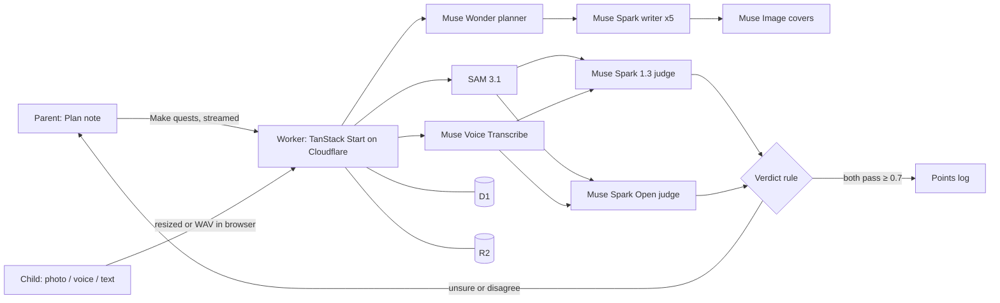

<div align="center">

# 🎲 GameSchooling

**Homeschool, played as quests.**

A Parent writes what each Child should learn. The Child proves it. Two Meta models check the proof.

[**▶ Try the live demo**](https://gameschooling.web.id) · [How it works](#how-it-works) · [Meta models](#meta-models) · [Run it locally](#run-it-locally)


</div>

---

## Why

Homeschooling Parents know what their Children should learn. What they lack is time: turning a goal into daily tasks, checking every answer, and keeping a six-year-old and a ten-year-old motivated at once. GameSchooling takes the Parent's plain-language Plan and runs the loop for them, while the Parent stays the final judge.

## How it works

```
 Parent writes a Plan  ──▶  Make quests  ──▶  Child plays a Quest  ──▶  Child sends a Proof
        ▲                                                                      │
        │                                                                      ▼
  Parent Accepts / Rejects  ◀──  unsure or disagree  ◀──  Two judges reach a Verdict
                                                                  │
                                                       both pass ≥ 0.7 ──▶ Points ──▶ Rewards
```

1. **Plan.** One free-text note per Child: what to learn, in which language, what to avoid, and which Rewards cost how many Points. Start from one of 47 **Starter Plans** (curriculum, faith, method and subject) for ages up to 18, then edit freely.
2. **Make quests.** One press turns the Plan into about five Quests, each with a cover, read aloud, a fixed Points value and one Proof kind. Progress streams to the screen as it happens.
3. **Guardian check.** Every Quest's text and cover prompt is checked for child safety before a Child sees it. A Quest that fails twice is dropped and shown to the Parent with the reason.
4. **Play.** The Child picks their name (optionally behind a PIN), taps a cover, listens, and submits a **Proof**: a photo, a voice recording, typed text (age 8+), or a photographed worksheet (age 6+) with a Verdict per answer.
5. **Verdict.** Two independent judges must both pass the Proof with confidence ≥ 0.7 before Points are paid. Anything unsure goes to the Parent, who can also overrule any automatic Verdict.

## Features

| For the Child                                       | For the Parent                                                                     |
| --------------------------------------------------- | ---------------------------------------------------------------------------------- |
| Illustrated Quest covers, read aloud                | Plan per Child, in any language, with Rewards and prices                           |
| Photo, voice, text and worksheet Proofs             | 47 Starter Plans with category tabs, filters and an age switch                     |
| Points, Rewards and weekly **Streaks** with freezes | Every Verdict with both judges, SAM masks on the photo and the full model log      |
| Opt-in **Stakes** on harder Quests                  | Accept, Reject or **Overrule** any Verdict                                         |
| **Family Goal** and an opt-in **Sibling Board**     | Weekly **Digest** per Child, written by Muse Wonder                                |
| Optional Child PIN                                  | Optional **Parent PIN** for a shared device; multiple Parents per Family by invite |

Words in bold are defined in [`GLOSSARY.md`](GLOSSARY.md).

## Meta models

Seven model jobs, each logged with the actual model used, tokens, cost and latency.

| Model                                                            | Job                                                                                | Why                                                                                                                                                      |
| ---------------------------------------------------------------- | ---------------------------------------------------------------------------------- | -------------------------------------------------------------------------------------------------------------------------------------------------------- |
| **Muse Wonder** `muse-wonder-1.0`                                | Planner: turns a Plan into about five Quest briefs and reads the Rewards out of it | Long reasoning over the Plan, the Child's age and recent outcomes. Falls back to Muse Spark 1.3 (shown in the model log)                                 |
| **Muse Spark 1.3** `muse-spark-1.3`                              | Writer: one Quest per brief, strict JSON, in the Plan's language                   | Fast structured output with the Plan's avoid list and a child-safety instruction                                                                         |
| **Muse Image** `muse-image-1.0`                                  | Illustrator: one cover per Quest                                                   | Covers are what a 6-year-old taps; spaced 500 ms for the 150 RPM limit                                                                                   |
| **SAM 3.1** `sam-3.1`                                            | Segmenter: finds each thing a photo Quest asks for                                 | Visible evidence: counts go to the judges, masks are drawn over the photo for the Parent                                                                 |
| **Muse Voice Transcribe** `muse-voice-transcribe-1.0`            | Transcriber: diarized, biased to Indonesian, Arabic and English                    | Tells the Parent's prompting apart from the Child's answer; audio is never stored                                                                        |
| **Muse Spark 1.3** `muse-spark-1.3`                              | Judge: pass or fail, confidence, reason                                            | Sees the photo plus SAM findings, the transcript, or the typed answer                                                                                    |
| **Muse Spark Open** `meta-models/muse-spark-open-1026` (Baseten) | Second judge: same input, independent decision                                     | Two models must both accept with confidence ≥ 0.7 before Points are paid. If Baseten rejects the photo it judges from text, and the log says "text only" |

## Architecture



Every model call writes a model log row (agent, actual model, input summary, output, tokens, cost, latency, error), shown under each Quest and Verdict. Points come only from an insert-only Points log, so a balance can always be traced back to the Verdicts that earned it.

## Try it

Live at **[gameschooling.web.id](https://gameschooling.web.id)**. No sign-up needed for the demo.

1. Press **Demo**. You are the Parent of Nadia (6) and Umar (10).
2. Nadia has a dot: open "Alif, ba, ta". Recitation always comes to the Parent. Press Accept and watch her Points move.
3. Press **Make quests** and watch the progress lines; open a new Quest to see its model log and cost.
4. Press **Play**, pick a name, tap a cover, press Play to hear it, and submit a Proof.
5. Back as Parent, open the Verdict: both judges, SAM masks on the photo, the full model log. Accept or Reject any Verdict, including automatic ones.

## Privacy and safety

- **Parent-supervised.** No Child accounts; Children play on the Parent's device with a nickname and birth year only.
- **No Child names sent to models.**
- **Voice deleted after transcription**, never stored.
- **Guardian check** on every Quest's text and cover prompt before a Child sees it.
- **The Parent has the last word** on every Verdict.

Full text: [Privacy Policy](https://gameschooling.web.id/privacy) · [Terms of Use](https://gameschooling.web.id/terms).

## Run it locally

```bash
pnpm install
cp .env.example .dev.vars   # fill in keys
pnpm dev                    # http://localhost:3000, local D1 and R2
pnpm check                  # oxlint, oxfmt, tsc, tests
pnpm smoke                  # one call to every model endpoint
pnpm seed                   # rebuild the Demo Family locally
```

### Deploy

1. Create the D1 database and R2 bucket:
   ```bash
   wrangler d1 create gameschooling
   wrangler r2 bucket create gameschooling
   ```
2. Put the D1 id in `wrangler.jsonc` and set secrets with `wrangler secret put`.
3. Run `pnpm deploy` (builds, applies remote migrations, deploys the Worker).

Production runs on the custom domain `gameschooling.web.id` (Cloudflare zone, `routes` in `wrangler.jsonc`): `BETTER_AUTH_URL` is `https://gameschooling.web.id`, and the Google OAuth client lists `https://gameschooling.web.id/api/auth/callback/google` as a redirect URI. Demo photos and covers go in R2 under `demo/` (`leaves.jpg`, `blue.jpg`, `apple.jpg`, `cover-<child>-<quest>.webp`).

### Stack

TanStack Start on Cloudflare Workers · D1 with Drizzle · R2 · Better Auth (Google) · shadcn/ui on Tailwind · oxlint and oxfmt · Vitest. Contributor and agent notes are in [`AGENTS.md`](AGENTS.md) and domain words in [`GLOSSARY.md`](GLOSSARY.md).

## Built at the Meta AI Developer Hackathon

Everything in this repository was written during the Meta AI Developer Hackathon, starting 2026-11-03 from first commit `255d03a` (empty repo with a licence). Nothing predates the event.

## License

See [`LICENSE`](LICENSE).

---

Built with Muse Spark Open. Also uses Meta's Muse Wonder, Muse Spark 1.3, Muse Image, SAM 3.1 and Muse Voice Transcribe.
