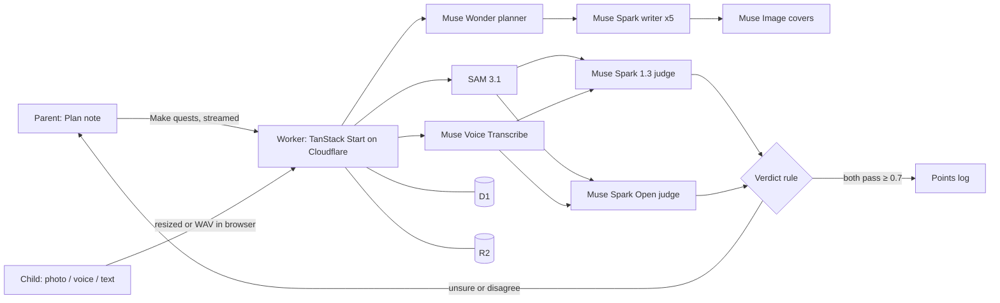

# GameSchooling

## What was built during the hackathon

Everything in this repository was written during the Meta AI Developer Hackathon, starting 2026-11-03 from first commit `255d03a` (empty repo with a licence). Nothing predates the event.

A Parent writes what each Child should learn. The Child proves it. Models check the proof.

## Meta models

| Model                                                        | Job                                                                                | Why                                                                                                                                                      |
| ------------------------------------------------------------ | ---------------------------------------------------------------------------------- | -------------------------------------------------------------------------------------------------------------------------------------------------------- |
| Muse Wonder `muse-wonder-1.0`                                | Planner: turns a Plan into about five Quest briefs and reads the Rewards out of it | Long reasoning over the Plan, the Child's age and recent outcomes. Falls back to Muse Spark 1.3 (shown in the model log)                                 |
| Muse Spark 1.3 `muse-spark-1.3`                              | Writer: one Quest per brief, strict JSON, in the Plan's language                   | Fast structured output with the Plan's avoid list and a child-safety instruction                                                                         |
| Muse Image `muse-image-1.0`                                  | Illustrator: one cover per Quest                                                   | Covers are what a 6-year-old taps; spaced 500 ms for the 150 RPM limit                                                                                   |
| SAM 3.1 `sam-3.1`                                            | Segmenter: finds each thing a photo Quest asks for                                 | Visible evidence: counts go to the judges, masks are drawn over the photo for the Parent                                                                 |
| Muse Voice Transcribe `muse-voice-transcribe-1.0`            | Transcriber: diarized, biased to Indonesian, Arabic and English                    | Tells the Parent's prompting apart from the Child's answer; audio is never stored                                                                        |
| Muse Spark 1.3 `muse-spark-1.3`                              | Judge: pass or fail, confidence, reason                                            | Sees the photo plus SAM findings, the transcript, or the typed answer                                                                                    |
| Muse Spark Open `meta-models/muse-spark-open-1026` (Baseten) | Second judge: same input, independent decision                                     | Two models must both accept with confidence ≥ 0.7 before Points are paid. If Baseten rejects the photo it judges from text, and the log says "text only" |

## Architecture



Every model call writes a model log row (agent, actual model, input summary, output, tokens, cost, latency, error), shown under each Quest and Verdict.

## Try it

Live: https://gameschooling.web.id

1. Press **Demo**. You are the Parent of Nadia (6) and Umar (10).
2. Nadia has a dot: open "Alif, ba, ta". Recitation always comes to the Parent. Press Accept and watch her Points move.
3. Press **Make quests** and watch the progress lines; open a new Quest to see its model log and cost.
4. Press **Play**, pick a name, tap a cover, press Play to hear it, and submit a Proof.
5. Back as Parent, open the Verdict: both judges, SAM masks on the photo, the full model log. Accept or Reject any Verdict, including automatic ones.

Privacy: Parent-supervised, no Child accounts, no Child names sent to models, voice deleted after transcription (never stored).

## Run it

```bash
pnpm install
cp .env.example .dev.vars   # fill in keys
pnpm dev                         # http://localhost:3000, local D1 and R2
pnpm check                       # oxlint, oxfmt, tsc, tests
pnpm smoke                       # one call to every model endpoint
pnpm seed                        # rebuild the Demo Family locally
```

Deploy: create the D1 database and R2 bucket (`wrangler d1 create gameschooling`, `wrangler r2 bucket create gameschooling`), put the D1 id in `wrangler.jsonc`, set secrets with `wrangler secret put`, then `pnpm deploy`. Production runs on the custom domain `gameschooling.web.id` (Cloudflare zone, `routes` in `wrangler.jsonc`): `BETTER_AUTH_URL` is `https://gameschooling.web.id`, and the Google OAuth client lists `https://gameschooling.web.id/api/auth/callback/google` as a redirect URI. Demo photos and covers go in R2 under `demo/` (`leaves.jpg`, `blue.jpg`, `apple.jpg`, `cover-<child>-<quest>.webp`).

Stack: TanStack Start on Cloudflare Workers, D1 with Drizzle, R2, Better Auth (Google), shadcn/ui on Tailwind, oxlint and oxfmt, Vitest. See [`AGENTS.md`](AGENTS.md).

Built with Muse Spark Open.
